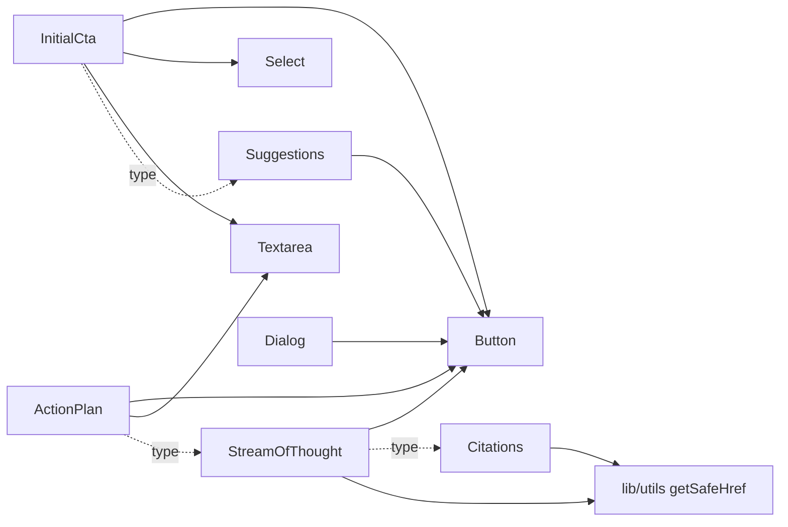

# CONTEXT.md

Persistent context for developers and AI coding assistants working on **DS Core AI**. Read this before exploring the codebase. Keep it up to date when components, tokens, or conventions change.

> The [README.md](README.md) is shadcn/Vite template boilerplate — this file is the real project overview.

## 1. What this is

**XDS (Experience Design System)** — a React component library focused on AI-assistant UI (prompt composer, suggestions, citations, stream-of-thought, action plan), plus a single-page showcase app. The app previews each component and includes a working **Chatbot** example that combines them.

- Owner: DD&IT Experience & Adoption
- Package version: `0.0.1` (private); component files carry their own `Version: 0.1.0` header
- No backend, no router, no tests

## 2. Tech stack

| Area | Choice | Notes |
|---|---|---|
| Framework | React 19 + `react-dom` 19 | Client-only SPA, no RSC, no `"use client"` |
| Build | Vite 8 + `@vitejs/plugin-react` | Alias `@` → `./src` ([vite.config.ts](vite.config.ts)) |
| Language | TypeScript ~6, `strict`, `verbatimModuleSyntax` | Use `import type` for type-only imports |
| Styling | Tailwind CSS v4 via `@tailwindcss/vite` | **No `tailwind.config.*`** — tokens live in CSS `@theme` blocks |
| Primitives | `@base-ui/react` | **Not Radix.** Composition uses the `render` prop, not `asChild` |
| Variants | `class-variance-authority` (CVA) | |
| Class merge | `cn` npm package (`^0.5.0`) | Imported directly as `import { cn } from "cn"`; also re-exported from `@/lib/utils` |
| Icons | `lucide-react` | Import individually |
| Animation | `tw-animate-css` | `animate-in`, `fade-in-0`, `slide-in-from-*`, etc. |
| Scaffolding | shadcn CLI 4, style `base-nova` | See [components.json](components.json) |
| Quality | ESLint 10 (TS, react-hooks, react-refresh), Prettier 3 + `prettier-plugin-tailwindcss` | [.prettierrc](.prettierrc): no semicolons, double quotes, `trailingComma: es5`, width 80; sorts classes inside `cn()`/`cva()` |

## 3. Commands

Run from the project root.

| Command | Purpose |
|---|---|
| `npm run dev` | Vite dev server (http://127.0.0.1:5173) |
| `npm run build` | `tsc -b && vite build` |
| `npm run lint` | ESLint |
| `npm run typecheck` | `tsc --noEmit` |
| `npm run format` | Prettier on `**/*.{ts,tsx}` |
| `npm run preview` | Preview the production build |

There is no test runner. Validate changes with `npm run lint && npm run build`.

## 4. Directory map

```
DS Core AI/
├─ components.json            shadcn config (+ @xds registry)
├─ .prettierrc                Prettier + Tailwind class sorting
├─ vite.config.ts             react + tailwind plugins, @ alias
├─ styles/                    ← design tokens live OUTSIDE src/
│  ├─ theme.css               @theme palettes, semantic tokens, light/.dark values
│  └─ fonts.css               @font-face for VoltaModernDisplay
├─ public/assets/xds/
│  ├─ fonts/                  VoltaModernDisplay-{55Roman,65Medium,75Bold}.woff2
│  └─ logo/                   brand-symbol-*.svg, logo-*.svg (soft-white / warm-black)
└─ src/
   ├─ main.tsx                StrictMode → ThemeProvider → App
   ├─ App.tsx                 Showcase app (grouped sidebar + preview + code panel)
   ├─ examples/
   │  └─ chatbot-example.tsx  Full chat demo composed from XDS components
   ├─ index.css               Imports tailwindcss, tw-animate-css, shadcn/tailwind.css, ../styles/*
   ├─ components/
   │  ├─ xds/                 ← SOURCE OF TRUTH for all components
   │  ├─ ui/button.tsx        Re-export shim of xds/button (for shadcn-generated imports)
   │  └─ theme-provider.tsx   ThemeProvider + useTheme
   └─ lib/utils.ts            cn re-export, getSafeHref()
```

## 5. Component catalog (`src/components/xds/`)

| File | Exports | Key API | Built on / depends on |
|---|---|---|---|
| [action-plan.tsx](src/components/xds/action-plan.tsx) | `ActionPlan`, types `ActionPlanStep`, `ActionPlanStepStatus`, `ActionPlanStatus`, `ActionPlanMode`, `ActionPlanProps` | `mode`: `contractual` (default, approval gate) \| `advisory` (no approval footer; read-only unless `editable`). `status`: `draft` \| `approved` \| `running` \| `complete` \| `cancelled`. Step `status`: `pending` \| `running` \| `complete` \| `skipped` \| `error`. Controlled `steps`/`onStepsChange` (editing needs `onStepsChange`; `editable` defaults to contractual drafts): inline edit, add/remove, drag or keyboard reorder (grip: Space lift, arrows move, Esc cancel). `onApprove(steps)`, `onRegenerate`, `onCancel`, `approveLabel`; `open`/`defaultOpen`/`onOpenChange` | `Button`, `Textarea`, `ThoughtStepKind` type |
| [button.tsx](src/components/xds/button.tsx) | `Button`, `buttonVariants` | `variant`: `primary` (default), `outline`, `secondary`, `tertiary`, `destructive`, `link`. `size`: `default`, `xs`, `sm`, `lg`, `icon`, `icon-xs`, `icon-sm`, `icon-lg` | `@base-ui/react/button`, CVA |
| [card.tsx](src/components/xds/card.tsx) | `Card`, `CardHeader`, `CardTitle`, `CardDescription`, `CardAction`, `CardContent`, `CardFooter` | `Card size`: `default` \| `sm` (drives `--card-spacing`) | Plain `div`s |
| [citations.tsx](src/components/xds/citations.tsx) | `Citations`, `CitationReference`, types `CitationItem`, `CitationsProps`, `CitationReferenceProps` | `Citations items={CitationItem[]}` wraps content; `<CitationReference citationId="…" />` renders numbered inline link to the reference list. `CitationItem = { id, title, href, source?, locator? }` | React Context, `useId`, `getSafeHref` |
| [dialog.tsx](src/components/xds/dialog.tsx) | `Dialog`, `DialogTrigger`, `DialogPortal`, `DialogOverlay`, `DialogContent`, `DialogHeader`, `DialogFooter`, `DialogTitle`, `DialogDescription` | Centered modal (`max-w-lg`). `DialogContent showCloseButton` (default `true`, tertiary `icon-sm` button) | `@base-ui/react/dialog` (portal + blurred backdrop), `Button` |
| [initial-cta.tsx](src/components/xds/initial-cta.tsx) | `InitialCta`, types `InitialCtaProps`, `InitialCtaMode`, `InitialCtaTemplate`, `InitialCtaSubmitPayload`, `InitialCtaSuggestion` | `variant`: `standard` \| `chat`. Controlled `value`/`onValueChange`, `attachments`/`onAttachmentsChange`, `attachmentError`/`onAttachmentErrorDismiss`, `onSubmit({ prompt, attachments, mode?, templateId? })`, optional `modes`/`mode`, `templates`/`templateId`, `onAttach`, `onVoiceInput`, `disclaimer`, `disabled` | `Button`, `Select`, `Textarea`, `SuggestionItem` type |
| [select.tsx](src/components/xds/select.tsx) | `Select`, `SelectTrigger`, `SelectValue`, `SelectContent`, `SelectItem`, `SelectGroup`, `SelectLabel`, `SelectSeparator`, `SelectScrollUpButton`, `SelectScrollDownButton` | `SelectTrigger size`: `default` \| `sm`. `SelectContent` accepts `side`, `sideOffset`, `align`, `alignOffset`, `alignItemWithTrigger` | `@base-ui/react/select` (portal) |
| [sheet.tsx](src/components/xds/sheet.tsx) | `Sheet`, `SheetTrigger`, `SheetClose`, `SheetContent`, `SheetHeader`, `SheetFooter`, `SheetTitle`, `SheetDescription` | `SheetContent side`: `top` \| `right` (default) \| `bottom` \| `left`; `showCloseButton` (default `true`) | `@base-ui/react/dialog` (portal + backdrop) |
| [stream-of-thought.tsx](src/components/xds/stream-of-thought.tsx) | `StreamOfThought`, types `ThoughtStep`, `ThoughtStepStatus`, `ThoughtStepKind`, `ThoughtStepDetail`, `StreamOfThoughtStatus`, `StreamOfThoughtProps` | `status`: `thinking` \| `waiting` \| `complete` \| `error` \| `stopped`. Step `status`: `queued` \| `running` \| `waiting` \| `error` \| `retried` \| `complete`. Step `kind`: `reasoning` \| `search` \| `read` \| `tool` \| `code`. Callbacks `onStop`, `onApprove`, `onReject`, `onRetry`; `open`/`defaultOpen`/`onOpenChange`; durations in **seconds** | `Button`, `CitationItem` (step `sources`), `getSafeHref` |
| [suggestions.tsx](src/components/xds/suggestions.tsx) | `Suggestions`, types `SuggestionItem`, `SuggestionsProps` | `items: { label, prompt }[]`, `onSelect(prompt)`, `disabled`. Renders nothing when `items` is empty | `Button` (`size="sm"`, `variant="secondary"`) |
| [textarea.tsx](src/components/xds/textarea.tsx) | `Textarea` | Native `textarea` props; auto-grows via `field-sizing-content` | Plain `textarea` |

Internal dependency graph:



## 6. Design tokens ([styles/theme.css](styles/theme.css))

- **Tailwind defaults are reset**: `--color-*: initial` and `--font-weight-*: initial`. Default Tailwind colors like `blue-500`, `slate-*`, `zinc-*` **do not exist**. Only the palettes below are available.
- **Palettes** (`100`–`900`, plus a bare alias = `500`):
  - `gray-*`
  - `space-orange-*` (brand accent, `space-orange` = `#ff4e00`)
  - `red-*`, `green-*`, `amber-*`
  - Singles: `white`, `soft-white`, `warm-black`, `black` (= `warm-black`)
- **Semantic tokens** (prefer these in components): `background`, `foreground`, `card`, `popover`, `primary`, `secondary`, `muted`, `accent`, `accent-brand` (space orange), `destructive`, `danger`, `success`, `warning`, `disabled`, `border`, `input`, `ring`, `sidebar-*`, `chart-1`…`chart-20`. Most have a `-foreground` pair.
- **Light/dark**: values defined in `:root` and `.dark`. Dark mode uses `@custom-variant dark (&:is(.dark *))`, so the `dark:` utility works when `.dark` is on an ancestor (set on `<html>` by `ThemeProvider`).
- **Font weights**: only `normal` (400), `medium` (500), `bold` (700) are defined, so utilities like `font-semibold` won't map to a theme weight.
- **Typography**: `--font-sans` = `VoltaModernDisplay` (from [styles/fonts.css](styles/fonts.css), served from `/assets/xds/fonts/`), fallback Arial.
- **Corners**: components use `rounded-none` (square XDS look) even though `--radius` tokens exist.
- To add a semantic token: define the raw value in `:root` and `.dark`, then map it in `@theme inline` as `--color-<name>: var(--<name>)`.

## 7. Theming ([src/components/theme-provider.tsx](src/components/theme-provider.tsx))

- `ThemeProvider` props: `defaultTheme` (`"system"`), `storageKey` (`"theme"`), `disableTransitionOnChange` (`true`).
- `useTheme()` returns `{ theme, setTheme }` where `theme` is `"light" | "dark" | "system"`.
- Applies `light`/`dark` class to `<html>`, follows OS changes in `system` mode, persists to `localStorage`, and syncs across tabs.
- **Keyboard shortcut**: pressing `d` (outside inputs/editable elements, no modifiers) toggles light/dark.

## 8. Showcase app ([src/App.tsx](src/App.tsx))

- Sidebar items are **auto-generated** from `import.meta.glob("./components/xds/*.tsx")`. Every file in `xds/` appears; the id is the filename (e.g. `initial-cta`).
- Items are grouped into collapsible `<details>` sections (`componentGroups`):
  - **General**: everything not listed in `conversationalAiIds`.
  - **Conversational AI**: ids in `conversationalAiIds` (`action-plan`, `citations`, `initial-cta`, `stream-of-thought`, `suggestions`).
  - **Example**: a hard-coded `chatbot` item that renders `ChatbotExample` in a tall section with no code panel.
- Content for each component comes from the `componentExamples` record, keyed by that id: `{ description, code, preview }`. `code` may be a string or a function of the preview props.
- Missing entries render a "Add a preview…" placeholder.
- No router: selection is local state, defaulting to `card`. Hash URLs like `#citation-<instanceId>-<citationId>` are just in-page citation anchors.
- Stateful demos live in `*Preview` functions. Examples: `StreamOfThoughtPreview` simulates a run with timed steps, an error step, and an approval step. `ActionPlanPreview` runs draft → approve → run, with a toggle between contractual and advisory (which runs immediately). `DialogPreview` shows a basic modal.

### Chatbot example ([src/examples/chatbot-example.tsx](src/examples/chatbot-example.tsx))

- Front-end only: replies are **canned responses** (`cannedResponses`) with sources, paragraphs that include citation ids, and follow-up suggestions. There is no API call.
- Each `Turn` animates on timers: stream of thought, an optional simulated error + retry, an optional approval step, then a word-by-word answer.
- Uses `InitialCta`, `Suggestions` (starters + follow-ups), `StreamOfThought`, `Citations`/`CitationReference`, `Sheet` (settings: `requireApproval`, `simulateError`, `streamAnswer`), `Dialog` + `Textarea` (feedback), and `Button`.
- Turn actions: new chat, edit prompt, copy prompt/answer (clipboard), like/dislike feedback.
- Use it as the reference for how XDS components fit together in a real conversation layout.

## 9. Conventions

- **Function components** with named exports collected at the bottom of the file: `export { Button, buttonVariants }`.
- **Props**: extend native or base-ui props (`React.ComponentProps<"div">`, `SelectPrimitive.Trigger.Props`), destructure `className`, spread `...props` last.
- **`data-slot`** on every part (`data-slot="card-header"`, `"select-trigger"`…), plus `data-size`/`data-side` for variant state. Parents style children with selectors like `has-data-[slot=card-footer]:` and `*:data-[slot=select-value]:`.
- **Variants**: CVA for multi-variant components (export the variants helper); simple size props use `data-[size=…]` selectors instead.
- **Class merging**: always `cn(baseClasses, className)` so consumers can override.
- **File header** for each XDS component:
  ```ts
  /**
   * <Component Name>
   * XDS — Experience Design System
   * Version: 0.1.0
   * Owner: DD&IT Experience & Adoption
   */
  ```
- **Composition**: base-ui `render` prop, e.g. `<SheetTrigger render={<Button />}>Open</SheetTrigger>`.
- **Links from data** (citations, sources) must go through `getSafeHref()`. It allows only http(s) and relative URLs and throws otherwise.
- **Accessibility**: provide `ariaLabel` props with sensible defaults; use `useId` for ARIA relationships.
- **Imports**: `@/` alias for internal modules; `import type` for types.
- Styling is Tailwind utilities only. Don't add new CSS files or inline style objects for component styling.

## 10. Adding or changing a component

1. Create `src/components/xds/<kebab-name>.tsx`, or pull one from the registry: `npx shadcn@latest add @xds/<name>`. The `@xds` registry is configured in [components.json](components.json).
2. If the CLI generates into `src/components/ui/`, move the implementation to `xds/` and keep `ui/` as a re-export only.
3. Add the XDS header, `data-slot` attributes, and named exports.
4. Add an entry to `componentExamples` in [src/App.tsx](src/App.tsx) keyed by the filename. If it's an AI-specific component, also add its id to `conversationalAiIds`.
5. Run `npm run lint && npm run build`.
6. Update the catalog in this file.

## 11. Gotchas for AI assistants

- **base-ui, not Radix**: don't use `asChild`, `@radix-ui/*`, or Radix prop names. Check the base-ui API (`render`, `Popup`, `Positioner`, `Backdrop`, `data-open`/`data-closed`).
- **Tailwind v4 only**: no `tailwind.config.js`, no `theme.extend`. Use CSS-variable syntax like `gap-(--card-spacing)` and `max-h-(--available-height)`.
- **Default Tailwind colors are removed**, so use the XDS palettes or semantic tokens.
- **Tokens live in `/styles`, not `/src`.**
- **Edit `xds/`, not `ui/`.** `ui/button.tsx` is only a shim.
- `cn` is the `cn` npm package, not a local `clsx` + `tailwind-merge` helper.
- Components are controlled-friendly. For example, `InitialCta` requires `value` and `onValueChange`.
- `StreamOfThought` durations are in seconds.
- `dialog.tsx` has no XDS header comment yet; the other component files do.
- Composite demos belong in `src/examples/`, not `src/components/xds/`, because every file in `xds/` automatically appears as a sidebar component.
